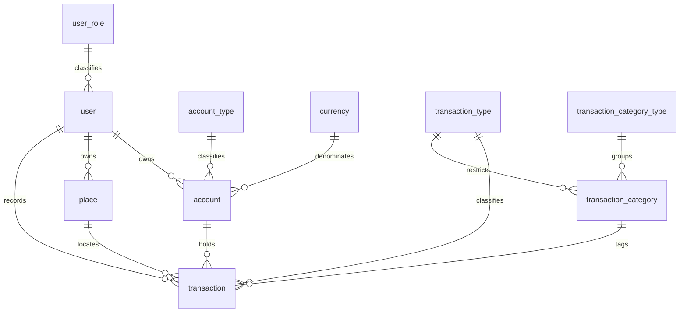

# Costs

A self-hosted personal finance tracker for costs and incomes across any number of accounts and currencies. It keeps each account balance current, stamps every transaction row with the balance before and after it, and reports by category, place, day and account over any date range.

A Laravel 7 REST API behind a Vue 2 single-page frontend on AdminLTE 3.

## Status

A solo personal project, built and used between September 2018 and February 2024. It does what I needed it to do, and I stopped working on it; the last substantial change added archiving in February 2024.

The dependency set is frozen in 2020–2021 and **will not install on a current PHP or Node**. See [Requirements](#requirements) before running anything.

## Stack

| Layer | Technology |
| --- | --- |
| Backend | PHP 7.4, Laravel 7, Guzzle 6, Intervention Image |
| API auth | Laravel Passport 8 (OAuth2); the SPA authenticates by session cookie via `CreateFreshApiToken` |
| Database | MySQL 5.7 |
| Frontend | Vue 2, Vue Router 3 (history mode), axios, vform |
| UI | AdminLTE 3 / Bootstrap 4, vue-good-table, SweetAlert2, moment |
| Charts | Chart.js 2 via vue-chartjs 3 |
| Build | Laravel Mix 5 (webpack 4), Sass |
| Local environment | Docker Compose — PHP-FPM, MySQL, nginx |

10 domain entities, 24 migrations, 12 REST resources, 10 server-side policies, 24 Vue components over 18 client-side routes.

## Features

### Transactions

- Record a cost or an income with a date, account, category, optional place and a free-text comment. Saving a transaction adjusts the owning account's balance and stamps the row with the balance immediately before and after it.
- Move money between your own accounts as a single transfer. The app writes the matching outgoing, incoming and optional fee rows inside one database transaction, or none at all if any of them fails. A transfer between accounts in different currencies takes an exchange rate.
- Beyond costs and incomes there are four *transferable* types — a plain transfer plus recharging a moneybox, a deposit or a saving account. All four use the same From/To + optional-fee form and the same atomic multi-leg write, which is what feeds the deposits, moneybox and savings totals on the statistics screen.
- The entry form changes with the selected type: transfers swap the single account select for From/To plus a fee field, the exchange-rate field appears only when the two accounts differ in currency, place is hidden for incomes and transfers, the category list is restricted to categories valid for that type, and account options show their live balance.
- *Save and continue* re-opens the form immediately after saving, keeping the same date, type and account, for logging several expenses in one sitting. *Copy* pre-fills a new transaction from an existing one.
- The history is a server-driven table: date-range picker, per-column filters, sorting and pagination all resolved in SQL, active filters shown as removable chips, and a column-visibility panel (including the normally hidden balance-before/after columns) whose choices persist in the browser.

### Accounts and places

- Any number of accounts, each with a name, a type (cash, credit card, moneybox, deposit, saving), a currency and a balance. The list filters by type.
- A per-account *don't calculate costs* flag keeps a chosen account out of every spending statistic — useful for a savings or business account.
- Accounts and places can be **archived** rather than deleted: an archived item disappears from the transaction form and sinks to the bottom of the management list, while its historical transactions stay intact.
- A personal list of places to attach to transactions, so spending can be grouped by where it happened.

### Dashboard and statistics

- The dashboard compares this month with last month: transaction count, costs and incomes per currency, a per-currency total balance across the accounts that are neither archived nor flagged *don't calculate costs*, two doughnut charts of costs by category, and the fifteen most recent transactions.
- The statistics screen covers any date range: grand totals for costs, incomes, deposits, moneybox and other savings — each per currency and converted into a single base total — plus breakdowns of costs by place, by category, by day and by account.
- Rows in the by-category and by-account breakdowns link through into the transaction list, pre-filtered by that category or account.

### Administration

- Two roles, `user` and `admin`, seeded by migration. Ordinary users only reach their own accounts, places and transactions; admins additionally get a Management menu for users, account types, transaction types, categories, category themes and currencies.
- Laravel Passport's own UI for OAuth clients and personal access tokens, on a screen the SPA shows to admins.
- Profile editing with name, e-mail, password and an avatar uploaded from the browser (sent as base64, resized server-side to 128×128).

## Data model



A category is classified twice — once by spending theme (living, entertainments, education, gifts, …) and once by the transaction type it is valid for. That second edge is what lets the entry form narrow the category list as soon as income, cost or transfer is picked.

Currency lives on the account, never on the transaction, so sums are always stored in the currency they were spent in and are normalised only when a report is rendered.

## Architecture

**API.** Twelve resources registered as a single `Route::apiResources([...])` in `routes/api.php`, plus one hand-written route, `GET statistic/{from}/{to}`, which is the real statistics endpoint — `StatisticController@index` takes `$from` and `$to` as route parameters. Authentication is applied by inheritance rather than by route: every controller extends `API\BaseController`, whose only job is `$this->middleware('auth:api')`, and each method calls `$this->authorize(...)` explicitly. Ten of the twelve implement a shared `RestApiControllerInterface` for a uniform signature. Responses are Eloquent models, collections and paginator payloads straight to the client — no transformers, no envelope, and errors come from Laravel's own 403/404/422 handling.

**Authorisation.** Ten hand-written policies, each with a `before()` admin bypass and a non-stock `viewAll` ability ("list anybody's records", admin only) on top of viewAny/view/create/update/delete. The three user-owned entities — account, place and transaction — add a second non-stock ability, `viewOwn`. User data is ownership-based; the shared dictionaries are read-for-everyone, write-for-admins. `resources/js/Gate.js` mirrors the policy map client-side so the UI can hide what the server would refuse — a convenience layer, not the enforcement point.

**Domain.** Ten flat Eloquent models with real foreign keys throughout. Nine name their table explicitly and singularly (`account`, `transaction`, `place`, …); `User` keeps the framework's default `users`. `Transaction` is the only aggregate with behaviour: it overrides `save()`, `delete()` and `cancel()` to snapshot `balance_before`, apply a signed sum to the owning account, write `balance_after` and shift the running balances of every later row on that account. `processTransfer()` assembles the legs of a transfer inside a `DB::beginTransaction`.

**List querying.** `ParseRequestAbstractModel` is a small query-object base class extended by `Transaction`, `Account` and `Place`. It turns query-string parameters into an Eloquent query: filters whitelisted through a `FIELDS` constant (a two-element JSON array becomes `whereBetween`, longer becomes `whereIn`; `Transaction` and `Account` define one, `Place` does not), a free-form `columnFilters` blob, `sortField`/`sortType`, and `page`/`perPage` pagination defaulting to 50. That one class is what the remote-mode transactions table talks to.

**Statistics.** Two template-method hierarchies under `app/Models/Statistic/`: `StatisticAbstract` for breakdowns and `TotalsAbstract` for totals, so each of the five grand-total classes is about twenty lines and differs only by the transaction type it returns. Two verb-named services underneath — `GetByPeriod` and `GetCourses` — do the fetching and the rate lookup. Dependency injection is split across four purpose-specific service providers.

**Integration.** The currency client is layered rather than inline Guzzle: `RequestInterface` / `ConvertRequest` describe the call, `SendRequest` is a generic transport with logging and a retry limit, `Convert` is a one-method service, and `ConvertResponseFactory` builds a typed response object.

**Frontend.** One Vue instance over 18 routes — 16 screen paths plus a forbidden page and a catch-all — with no store and no lazy loading, served by a single catch-all Blade route so deep links work. `Transactions.vue` carries most of the app: 1,417 lines against 424 for the next-largest component.

```
app/
  *.php                       Domain models (User, Account, Transaction, ...)
  Http/Controllers/API/       12 resource controllers over BaseController
  Policies/                   10 policies, admin bypass in before()
  Models/Statistic/           Breakdown and totals hierarchies
  Models/Service/             GetByPeriod, GetCourses, CurrConv transport
  Console/Commands/CurrConv/  currconv:refresh
database/migrations/          24 migrations; also seed the reference data and the admin user
resources/js/                 Vue SPA: app.js, routes.js, Gate.js, policies/, components/
docker-compose/               fpm/Dockerfile and nginx/costs.conf
```

## Requirements

| | Needed | Notes |
| --- | --- | --- |
| PHP | 7.4 | `composer.json` requires `^7.3`; the Docker image pins 7.4. The lock file holds Laravel 7.7.1, Passport 8.4.3 and PHPUnit 8.5.3, none of which run on PHP 8 — `--ignore-platform-reqs` only moves the failure to runtime. |
| MySQL | 5.7 | What the compose file provides and what the schema was developed against. |
| Node | 14 / npm 6 — **only to rebuild the frontend** | `node-sass` is pinned at 5.0.0, which has no prebuilt binaries above Node 15 and falls back to a `node-gyp` source build that fails against modern V8 headers. `package-lock.json` is lockfileVersion 1. On Node 17+ the webpack 4 build additionally needs `NODE_OPTIONS=--openssl-legacy-provider`. |

The compiled bundles (`public/js/app.js`, `public/css/app.css`) are committed and current, and the Blade layout references them with `asset()` rather than `mix()`. **The frontend build is therefore optional** — the full UI works without ever touching npm. Run it only to change frontend code.

## Run it with Docker

Compose brings up three containers — `costs-app` (PHP-FPM), `costs-db` (MySQL 5.7) and `costs-nginx` — and installs nothing. The code arrives through a bind mount, so `composer install` is a step you run yourself.

On Docker Compose v2, substitute `docker compose` for `docker-compose` in every command below and in the Makefile; the `version:` key at the top of the file is obsolete there and will warn.

```bash
cp .env.example .env
```

**Edit `.env` before starting anything.** `docker-compose.yml` interpolates `DB_DATABASE`, `DB_USERNAME` and `DB_PASSWORD` into the MySQL container at start-up, so a stale `.env` provisions the database with the wrong credentials:

```dotenv
DB_HOST=costs-db
DB_PORT=3306
DB_DATABASE=costs
DB_USERNAME=costs
DB_PASSWORD=secret
```

`DB_USERNAME` is handed to the MySQL container as `MYSQL_USER`, and the official image refuses `root` there — with `DB_USERNAME=root` the container exits at start-up and every artisan command then fails to connect. `DB_PASSWORD` doubles as the root password.

```bash
docker-compose up -d
# on a cold start, give MySQL a few seconds to initialise before migrating
docker-compose exec costs-app composer install
docker-compose exec costs-app php artisan key:generate
docker-compose exec costs-app php artisan migrate
docker-compose exec costs-app php artisan passport:keys
```

Open <http://localhost>. Nginx binds host port 80 directly, so free it first if something else is listening. `costs-db` publishes no host port — to look inside the database, use `docker-compose exec costs-db mysql -ucosts -p costs`.

Make sure `public/img/profile/` is writable if you want to upload a profile photo; the directory is tracked, only its contents are ignored.

### Before your first `up`

- **The database has no volume.** `costs-db` mounts nothing on `/var/lib/mysql`, so `docker-compose down`, or removing the container any other way, destroys the data. Use `stop` / `start` between sessions, or add a named volume before you put anything in it you care about.
- **The build args carry a hardcoded identity.** `costs-app` is built with `user: timoffmax` and `uid: 1000`. If your host UID differs, change both before the first build, or the container user cannot write `storage/` and `bootstrap/cache/` through the bind mount.
- **Apple Silicon:** `mysql:5.7` publishes no arm64 image. Add `platform: linux/amd64` to `costs-db` and accept the emulation cost, or point `DB_HOST` at a MySQL you run yourself.

## Run it without Docker

Needs PHP 7.4 with `pdo_mysql`, `mbstring`, `gd`, `bcmath`, `exif` and `pcntl`, plus Composer and a MySQL 5.7 database.

```bash
composer install
cp .env.example .env          # then set the DB_* variables for your database
php artisan key:generate
php artisan migrate
php artisan passport:keys
php artisan serve
```

`passport:keys` is enough for sign-in — there is no OAuth grant dance to configure. (The Personal Access Tokens tab on the admin API Users screen additionally needs `php artisan passport:client --personal`; skip it unless you want that screen.) The `web` middleware group includes Passport's `CreateFreshApiToken`, so the SPA authenticates against `/api/*` with a cookie and never needs a client id or secret.

## First sign-in

`php artisan migrate` seeds everything needed to start: two roles, five account types, six transaction types, nine category themes, forty-two categories and four currencies (UAH, USD, EUR, RUB) — plus an administrator.

```
admin@costs.local / admin
```

Created by a migration, so every fresh install has them. Change the password, or delete the account and register your own, before the instance is reachable by anyone but you.

## Configuration reference

`.env.example` carries the Laravel 7 defaults. What actually matters:

| Variable | Required | Notes |
| --- | --- | --- |
| `APP_KEY` | Yes | Empty in the example; generate with `php artisan key:generate`. |
| `DB_CONNECTION`, `DB_HOST`, `DB_PORT` | Yes | `DB_HOST=costs-db` under Docker. |
| `DB_DATABASE`, `DB_USERNAME`, `DB_PASSWORD` | Yes | Also consumed by `docker-compose.yml` to provision the MySQL container. |
| `APP_ENV`, `APP_DEBUG`, `APP_URL`, `LOG_CHANNEL` | No | Framework defaults are fine locally. |
| `CURR_CONV_API_URL`, `CURR_CONV_API_KEY` | Optional | Only for the hourly exchange-rate refresh. |

`REDIS_*`, `PUSHER_*` and `MIX_PUSHER_*` are inherited from the Laravel skeleton and unused — nothing here broadcasts or talks to Redis. `MAIL_*` is used by exactly one thing: the stock "forgot password" flow that `Auth::routes()` registers.

### Currency rates

Conversion happens at read time in the statistics layer, using a `course` column on the `currency` table, so every report shows a per-currency breakdown alongside a converted total. `php artisan currconv:refresh` walks that table and pulls fresh rates from [currencyconverterapi.com](https://www.currencyconverterapi.com/) through a small layered client. It is scheduled `hourly()`, and the compose stack has no cron container, so nothing fires it unless the host has a scheduler entry:

```
* * * * * cd /path/to/project && php artisan schedule:run >> /dev/null 2>&1
```

**If you only use one currency, skip all of this.** With no API key nothing calls out, `course` stays at its default of 1, and every figure is correct.

If you do want it, two things to know: the base currency is hardcoded to `UAH` in the command, and the free `free.currconv.com` endpoint configured in `.env.example` has since been retired, so the job needs re-pointing at another provider. Per-currency figures are unaffected either way — only the converted totals go stale.

## Make targets

`node_modules/` is not committed and the image does not install it, so run the install once before any `js_*` target:

```bash
docker-compose exec costs-app npm install
```

Thin wrappers around `docker-compose exec costs-app`:

| Target | Runs |
| --- | --- |
| `make ssh_app` | `/bin/bash` — a shell in the app container |
| `make js_dev` | `npm run dev` |
| `make js_watch` | `npm run watch` |
| `make js_prod` | `npm run prod` |

## Known limitations

Written for one user on one machine, and honest about what that means:

- **Not hardened for a shared or public instance.** `role_id` is mass-assignable and the user policy only checks self-ownership, so a user can raise their own role through the profile endpoint; Passport's `/oauth/*` routes are registered with only `web` + `auth`, so any signed-in user reaches them whatever the admin-only screen suggests; `config/cors.php` allows all origins on `api/*`; and the seeded admin password is `admin`. Fine for a private install on a laptop, not for the open internet.
- **No meaningful test coverage.** `tests/` holds only Laravel's two stock `ExampleTest` files, and the feature stub fails out of the box — it asserts an unauthenticated `GET /` returns 200, but that route sits behind `auth` middleware and redirects to `/login`. Nothing exercises the balance arithmetic or the statistics engine, there is no CI, and the `phpmd` / `php_codesniffer` dev dependencies are declared but unwired.
- **Running balances are ordered by insertion, not by date.** `updateFollowingTransactions()` selects rows with `where('id', '>', ...)`, so back-dating a transaction leaves the before/after balances on the surrounding rows wrong. The account balance itself stays correct.
- **Transfer legs are unlinked rows.** Editing or deleting one side of a transfer does not touch the other, and the exchange rate used survives only as text appended to the comment.
- **Hard deletes only.** No soft deletes and no audit trail; archiving exists on accounts and places precisely because deleting a row that transactions reference fails at the foreign key.
- **Compiled bundles are committed.** That is what makes the app runnable without npm, and also what makes feature diffs noisy.
- A handful of smaller bugs are still open — the statistics drill-downs do not carry their date range across, one of them errors, and route ordering leaves the admin user list fetching a single record. Recorded here rather than fixed, since the project is closed.
